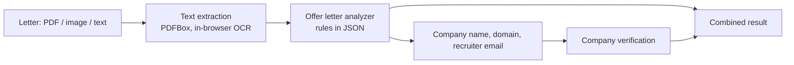

# TrustCheck

Check a job offer letter or a company for scam warning signs, before you share documents or pay anyone.


<!-- TODO: add 2 screenshots or one short GIF here:
     1. a scam letter flagged High risk, with the highlighted sentence
     2. the company check breakdown
     Blur any phone numbers, names or emails shown in the sample letters. -->

## Why this exists

Fake job offers are common in India and elsewhere. A typical one looks like a real offer letter and asks the
candidate for a "refundable security deposit", "registration fee" or "kit charges". TrustCheck gives candidates a fast second
opinion, with reasons they can check for themselves.

## What it does

**1. Offer letter analysis.** Upload a PDF, a screenshot or photo, a text file, or paste the text. The analyzer:
- flags letters that ask the *candidate* to pay money, and quotes the exact sentence;
- does not flag normal salary figures, "we do not charge any fee" disclaimers, or later-breach clauses such as notice-period buy-outs (these get a softer warning);
- looks for other scam patterns: free-mail recruiters, WhatsApp/Telegram-only contact, no interview, artificial urgency, pay that is too high for the role, requests for OTP or PIN;
- pulls out the company name, role, emails, domains and amounts, then **automatically verifies the company it found**.

**2. Company verification.** Scores a company from independent public signals (below) and shows a breakdown of every check, so the result is explainable.

## How a check flows



## Signals used for company verification

| Signal | What it tells us |
|---|---|
| Domain age (WHOIS) | Brand-new domains are a common scam sign |
| Website contact page | Real companies usually say how to reach them |
| HTTPS / TLS | Basic website hygiene |
| DNS (MX, SPF) | Whether the domain is set up for real company email |
| Recruiter email | Free-mail providers, or a domain that does not match the company |
| Blacklist | Names already reported as scams |
| OpenStreetMap (Nominatim) | Weak signal only: many real small companies are not listed |
| Reserved/test domains | Reported as "unable to assess" instead of guessed at |

Verdicts: Low risk indicators, Needs review, High risk indicators, Test domain / Unable to assess.

<!-- TODO: add the real weights/points from VerificationService so this stays accurate. -->

## Design decisions

- **Rule-based and explainable, not a black box.** Every flag shows the sentence or signal behind it. A candidate can disagree with a rule, which a model score would not allow.
- **Money is only a red flag when the candidate pays.** Every real letter mentions salary, so the analyzer looks at who is paying and skips sentences that say no fee is charged.
- **"We could not check" is never treated as "bad".** If WHOIS data is hidden or the map service is down, that check is skipped rather than penalised. Weak signals (map listing) carry small weight.
- **Rules live in `offer-rules.json`.** Adding a scam phrase needs no code change.
- **Privacy.** Letters are processed in memory and not stored. Images are read by OCR in the browser, so the picture never leaves the device.
- **Careful wording.** Results say "risk indicators", not "fake", because they are automated signals, not proof.

## Tech stack

Java 17, Spring Boot, Spring WebClient, Apache PDFBox, Jackson, Tesseract.js (in-browser OCR), vanilla HTML/CSS/JS, JUnit 5, GitHub Actions, hosted on Render.

## API

| Endpoint | Method | Purpose |
|---|---|---|
| /api/verify | POST | Verify a company (`name`, optional `city`, `website`, `domain`, `recruiterEmail`) |
| /api/offer-letter/analyze-text | POST | Analyze pasted letter text, `{"text": "..."}` |
| /api/offer-letter/analyze-file | POST | Analyze an uploaded PDF or TXT (multipart field `file`) |

The two offer-letter endpoints return the offer analysis plus `companyVerification` and `verificationNote`.

Example (trimmed):

```json
{
  "riskScore": 100,
  "riskLevel": "HIGH",
  "summary": "Offer from Global Soft Solutions Pvt Ltd. Risk level: HIGH (100/100). This letter asks you to pay money...",
  "redFlags": [
    {
      "code": "CANDIDATE_PAYMENT",
      "title": "Asks the candidate to pay money",
      "severity": "CRITICAL",
      "evidence": "To confirm your seat you need to pay a refundable registration fee of Rs 2,500 via UPI...",
      "advice": "Genuine employers do not charge candidates for jobs, training, kits or security. Do not pay anything."
    }
  ],
  "companyVerification": { "...": "..." }
}
```

## Run locally

Requirements: Java 17+, Maven.

```bash
git clone https://github.com/Pragyan2027/Fake-Company-Verifier.git
cd Fake-Company-Verifier
mvn spring-boot:run
```

Open <http://localhost:8080>. Set a real contact for OpenStreetMap's usage policy in `application.properties`:

```properties
app.nominatim.userAgent=TrustCheck/1.0 (your-email@example.com)
spring.servlet.multipart.max-file-size=5MB
spring.servlet.multipart.max-request-size=5MB
```

Run the tests with `mvn test`.

## Changing the rules

Edit `src/main/resources/offer-rules.json` (phrases, severities, thresholds, wording) and restart. A typo in the file stops the app at startup with a clear error instead of silently disabling a rule.

## Evaluating accuracy

`tools/EvalRunner.java` sends labelled letters to the running app and reports how many scam letters were caught and how many genuine letters were wrongly flagged:

```bash
java tools/EvalRunner.java http://localhost:8080 eval
```

<!-- TODO: after you run it, add a line like:
     "On a held-out set of N scam and M genuine letters: X% of scams rated High, Y% of genuine letters wrongly flagged." -->

## Limitations

- Rule-based detection can be reworded around. It catches the patterns it knows, so the rules need regular updating from real examples.
- English only for now.
- Scanned PDFs have no text layer. Take a screenshot of each page and upload the images.
- Many domain registries hide WHOIS data, so domain age is sometimes unavailable.
- The blacklist is small. Not being on it proves little.
- Automated signals, not legal or professional advice. Always confirm a job on the company's official website.

## Roadmap

- "Report a missed scam" button (with consent) to feed new rules
- Hindi and Hinglish phrase lists
- Registered-company lookup (MCA)
- Single combined verdict across letter and company

## Contributing

Found a scam phrase the app misses? Open an issue, or send a pull request adding it to `offer-rules.json` with an example letter (personal details removed).

## License

<!-- TODO: add a LICENSE file (MIT is a common choice for portfolio projects). -->
